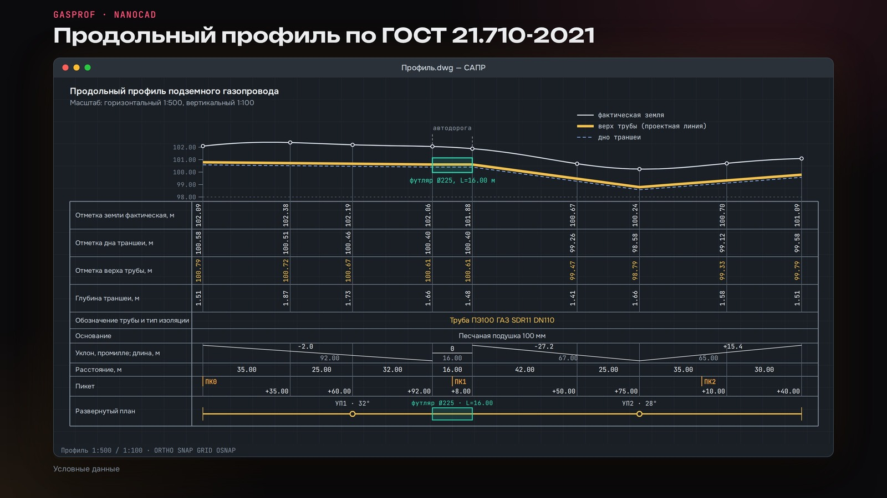
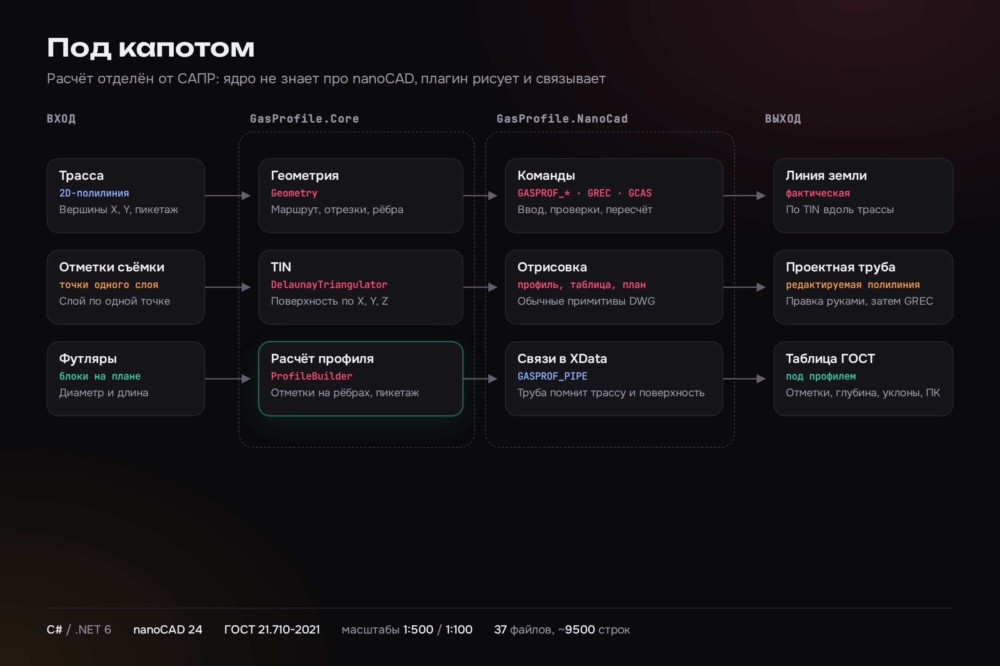

# GasProfile: плагин nanoCAD для продольного профиля газопровода

Плагин для проектировщиков наружных газопроводов. По 2D-трассе и отметкам топографической съёмки он строит продольный профиль подземного газопровода с таблицей под ним по ГОСТ 21.710-2021. Проектировщик выбирает трассу и одну отметочную точку. Остальные точки того же слоя плагин находит сам, строит поверхность, рисует фактическую землю, проектную трубу, таблицу и развёрнутый план.

Трубу можно поправить вручную, после чего одна команда (`GREC`) пересчитывает таблицу: отметки, глубины, уклоны, пикетаж. Дно траншеи считается с учётом наружного диаметра трубы и песчаной подушки 100 мм. Футляры и пересечения задаются блоками на плане и обновляют пикетаж на профиле. Профиль хранит связь с трассой, поверхностью и трубой (XData), поэтому его обновляют, а не перечерчивают. Масштаб по умолчанию 1:500 по горизонтали и 1:100 по вертикали.

Расчётное ядро (геометрия, TIN по Делоне, построение профиля) не зависит от nanoCAD и лежит в отдельной библиотеке.



На слайдах данные условные.



## Команды

| Команда | Что делает |
| --- | --- |
| `GASPROF_DRAW_TIN` | строит поверхность по отметкам |
| `GASPROF_DRAW_DRAFT` | строит чертёж профиля: земля, труба, таблица, развёрнутый план |
| `GREC` / `GASPROF_RECALC_PROFILE` | пересчитывает таблицу после правки трубы |
| `GCAS`, `GCEDIT`, `GASPROF_RECALC_CASINGS` | добавление, правка и пересчёт футляров |
| `GASPROF_ADD_SITUATION` | условные знаки ситуации на плане |
| `GVAL` / `GASPROF_VALIDATE`, `GASPROF_CHECK*` | проверки оформления и расчёта |
| `GSET` | настройки |
| `GASPROF_ABOUT` | версия плагина |

## Сборка и запуск

Нужны .NET 6 SDK (версия закреплена в `global.json`), Windows и установленный nanoCAD 24.1. Путь к библиотекам nanoCAD по умолчанию `C:\Program Files\Nanosoft\nanoCAD x64 24.1`, его можно переопределить свойством `NanoCadRoot`.

```powershell
dotnet restore .\GasProfile.sln
.\build.ps1
```

Скрипт кладёт сборку в `artifacts\GasProfile.NanoCad\<дата_время>\`. В nanoCAD: команда `NETLOAD`, выбрать `GasProfile.NanoCad.dll`, затем `GASPROF_ABOUT` для проверки. Подробности в `docs/dev-setup.md`.

Сборка и тесты в этой копии репозитория не запускались: подготовка выполнялась на машине без .NET и nanoCAD. Автоматических тестов в репозитории нет.

Демонстрационный чертёж (DWG) в репозиторий не включён.

## Стек

C# / .NET 6, nanoCAD API (`net6.0-windows`), PowerShell для сборки.

## Структура

- `src/GasProfile.Core` - геометрия, триангуляция Делоне, TIN, построение профиля и форматирование пикетажа;
- `src/GasProfile.NanoCad` - команды и отрисовка в nanoCAD, XData-связи;
- `docs/` - концепция, roadmap, спецификация оформления, библиотека блоков, перечень применяемых стандартов;
- `build.ps1`, `GasProfile.sln`, `global.json` - сборка.

Тексты стандартов (ГОСТ 21.710-2021 и связанные) в репозиторий не входят, на них даны ссылки по названию.

## Автор

Telegram-канал [@sitimlab](https://t.me/sitimlab) · сайт [sitimlab.ru](https://sitimlab.ru/?utm_source=github&utm_medium=profile)

## Лицензия

MIT — см. [LICENSE](LICENSE).
